# Calculus Studio

An interactive course web app that teaches calculus from the basics up to the level of the
MATH.APP.160 homework (integration, applications, techniques, improper integrals, ODEs, sequences
and series), plus a second course skeleton for electrical engineering.

Every module follows the same arc:

1. **Learn** — interactive graphs and animations first (Riemann sums, accumulation functions,
   solids of revolution, slope fields, a mass–spring–damper, Taylor polynomials, phasors, …).
2. **MATLAB Live Editor** — the same mathematics written the way homework and exams are written:
   LaTeX equations (Ctrl+Shift+L), English explanation before each step, MATLAB code for plots and
   numerical checks, never `syms`.
3. **Assignments** — homework-level problems with automatic checking of numbers, functions (up to a
   constant for antiderivatives) and choices, plus write-up problems with Live Script model solutions.

An **AI tutor** (Anthropic API) is built into every page: it answers questions with the current page
as context, diagnoses wrong answers, reviews Live Script write-ups, recommends what to focus on from
your progress, and generates new mini-lessons and auto-checkable practice problems on demand.

## Screenshots

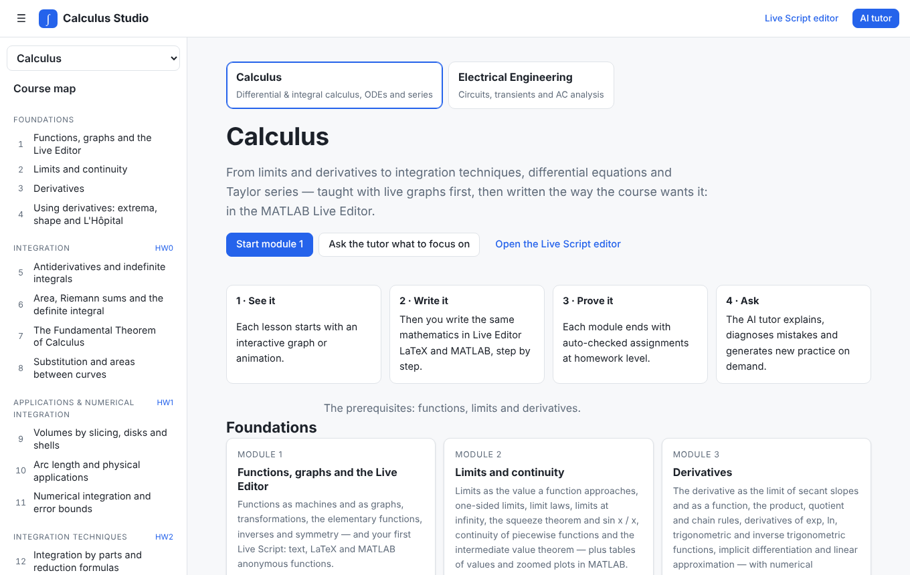

**Learn — interactive visuals first**

| Riemann sums | Accumulation function (FTC) |
|---|---|
| 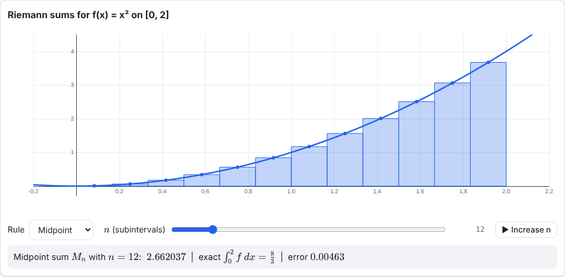 | 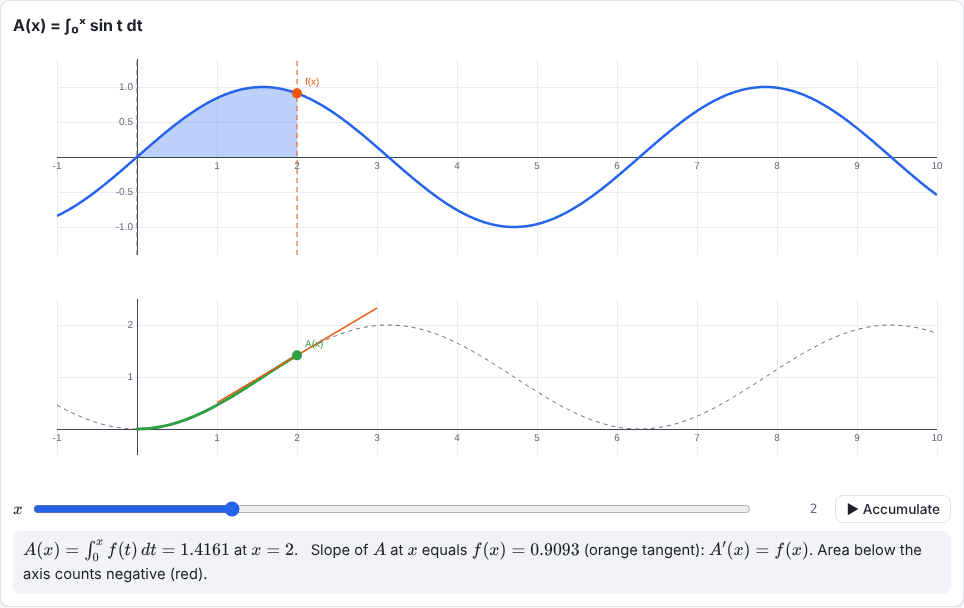 |
| **Solids of revolution** | **Slope field with solution curves** |
| 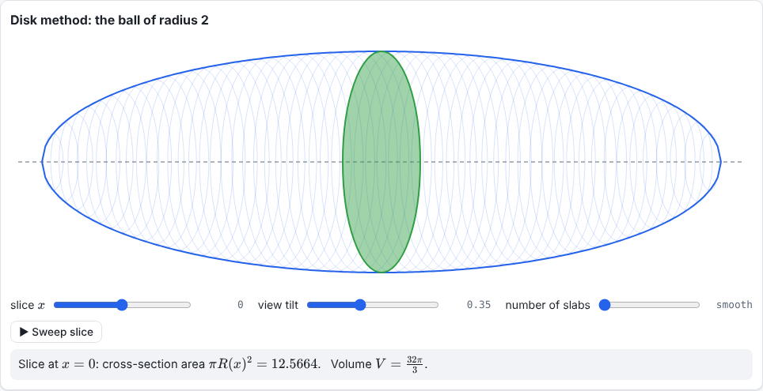 | 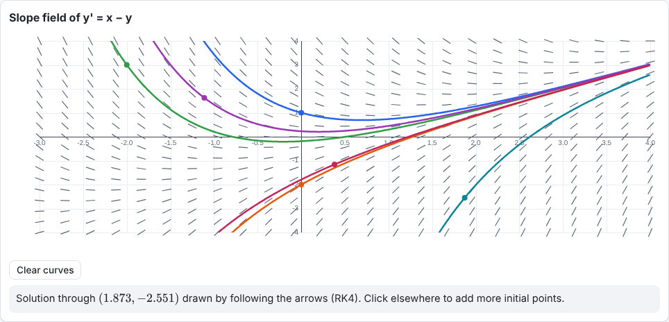 |
| **Mass–spring–damper** | **Taylor polynomials** |
| 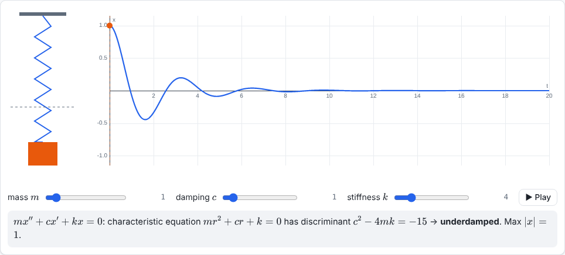 | 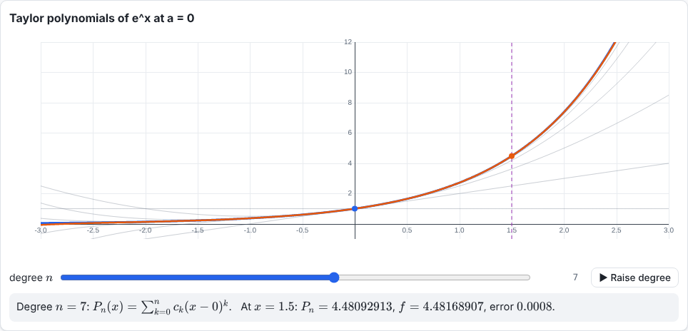 |

**Write it — MATLAB Live Editor format**

The Live Script editor with the Homework 0 model solution opened from its `.mlx` file:

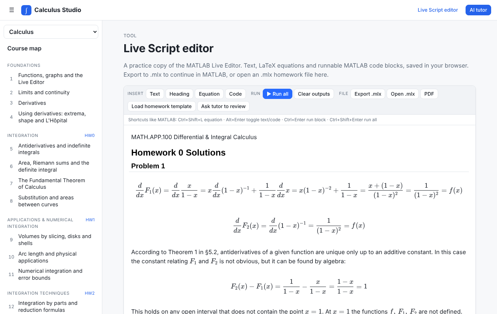

A MATLAB page with runnable code, inline output and figures:

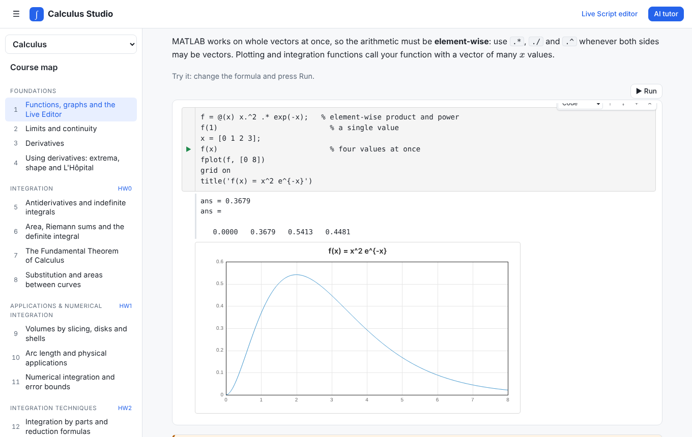

**Prove it — auto-checked assignments** (antiderivatives are accepted up to a constant)

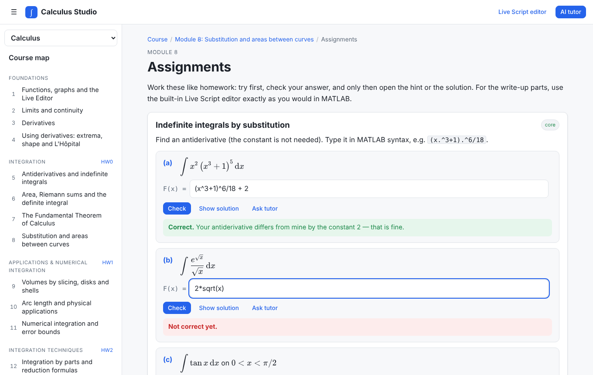

**AI tutor** (response shown is from a local test stub)

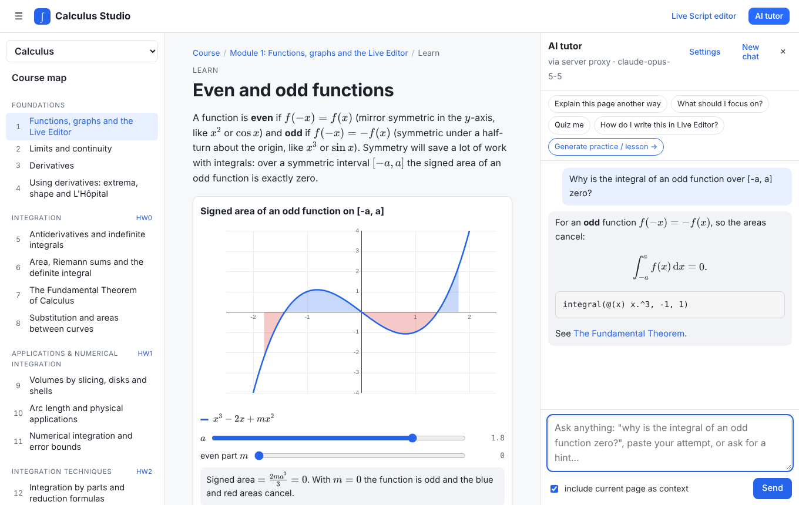

| Dark mode | Mobile (electrical engineering course) |
|---|---|
| 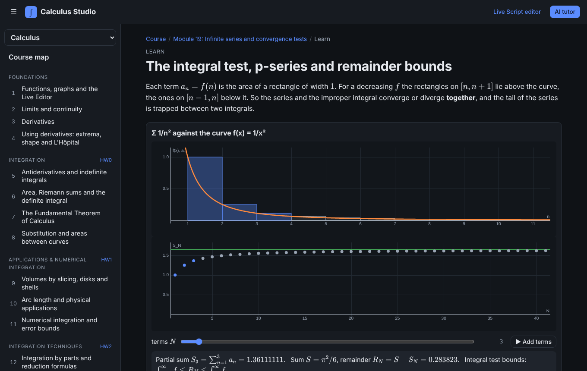 | 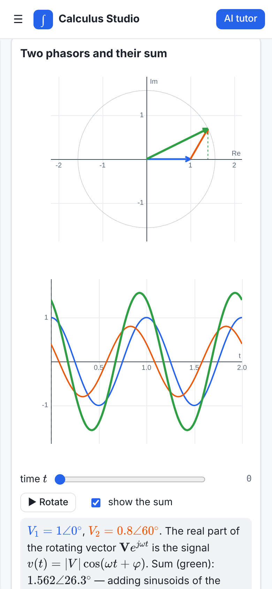 |

## Running

No build step. Requires Node 18+ only for the local server.

```bash
npm start                                   # http://127.0.0.1:8080
ANTHROPIC_API_KEY=sk-ant-... npm start      # with the AI tutor proxied through the server
```

The app is static, so any static host works (e.g. GitHub Pages). Without the server proxy, the tutor
can use a learner's own API key (AI tutor → Settings); that key is stored only in the browser's
localStorage and sent directly to api.anthropic.com.

Environment variables for `server.mjs`: `PORT` (8080), `HOST` (127.0.0.1), `ANTHROPIC_API_KEY`.
The proxy forwards only `/v1/messages`, `/v1/messages/count_tokens` and `/v1/models`.

## What is inside

| Path | Purpose |
|---|---|
| `js/matlab/` | A MATLAB-subset interpreter (parser, values, numerics): vectors/matrices, element-wise ops, anonymous and local functions, control flow, `integral`, `quad`, `trapz`, `fzero`, `fminbnd`, `roots`, `ode45`, `meshgrid`, plotting (`plot`, `fplot`, `quiver`, …). It runs code blocks, checks answers and rejects `syms` with a course-specific message. |
| `js/livescript.js`, `js/mlx.js`, `js/zip.js` | Live Editor imitation: text with inline LaTeX, display equations, runnable code with inline output and figures; `.mlx` export and import (open your homework files directly). |
| `js/widgets.js`, `js/plot.js` | The interactive visualisations and the canvas plotting library. |
| `js/blocks.js`, `js/check.js` | Lesson blocks, quizzes, LaTeX drills, MATLAB exercises, assignments and answer checking. |
| `js/ai.js`, `js/tutorpanel.js` | AI tutor: streaming chat, structured generation of lessons and assignments (validated against the sandbox before use). |
| `js/content/` | Courses, parts and modules (one file per module). See `CONTENT.md`. |
| `server.mjs` | Static server + Anthropic API proxy. |
| `tests/` | Interpreter and LaTeX unit tests, and a content validator that renders every formula, runs every MATLAB snippet and verifies every answer key. |

## Adding material

New homework topics become new modules: add a file under `js/content/<course>/`, register it in
`js/content/index.js`, and run `npm test`. The electrical engineering course (`js/content/ee/`) is
ready for its assignment-driven modules. The format is documented in `CONTENT.md`.

## Tests

```bash
npm test
node tests/validate-content.mjs ftc   # validate a single module while writing it
```
